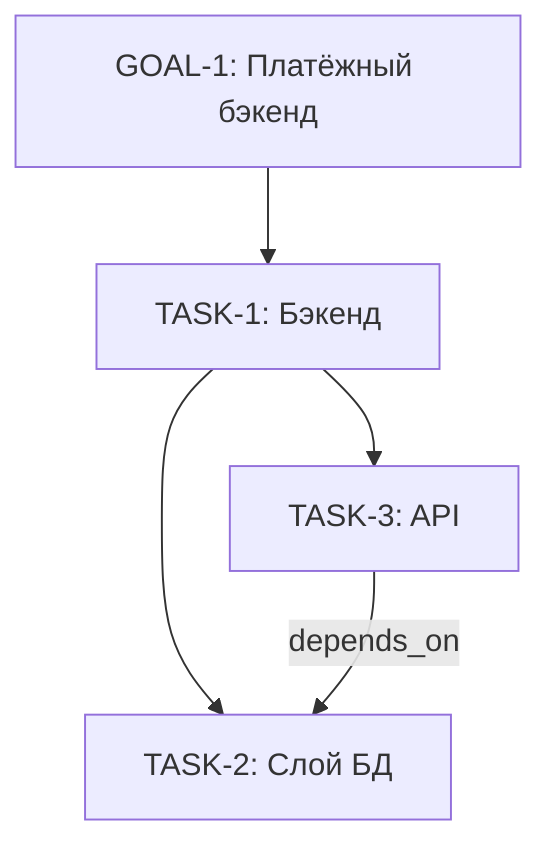

## 1. Что такое оркестрация

Оркестрация делит сложную цель на подзадачи, запускает агентов, ведёт их параллельно и проверяет результат. Оркестрация состоит из двух частей:

- **Рантайм** — часть IDE. Запускает агентов, применяет правила профилей, изолирует работу в ворктри.
- **TGS** — Task Graph Service. Хранит граф задач, статусы, артефакты и телеметрию.

Рантайм исполняет. TGS хранит и валидирует. Рантайм управляет TGS через MCP-инструменты.

## 2. Что такое TGS

TGS — сервис графа задач. Он подключается к IDE как MCP-сервер. Данные хранятся в локальной базе SQLite. TGS не запускает агентов. TGS отвечает за:

- цели и задачи;
- иерархию «родитель — потомок»;
- граф зависимостей (DAG) с защитой от циклов;
- машину состояний с валидацией переходов;
- контракты задач;
- артефакты и журнал событий;
- телеметрию (токены, стоимость, дифф).

Идентификаторы генерирует TGS: цель — `GOAL-N`, задача — `TASK-N`.

## 3. Управление TGS: инструменты рантайма

Рантайм и агенты работают с TGS через 13 MCP-инструментов.

### Задачи

| Инструмент | Действие |
|---|---|
| `task_create` | Создать задачу или пакет задач в одной транзакции. Задачи пакета связываются зависимостями по `temp_id`. |
| `task_get` | Получить карточку задачи: метрики, зависимости, контракт, последние 20 событий. |
| `task_update` | Изменить задачу: статус, поля, зависимости. Единственный способ изменения. |
| `task_delete` | Удалить архивированную задачу. Потомки отвязываются, не удаляются. |

### Цели

| Инструмент | Действие |
|---|---|
| `goal_create` | Создать цель. Цель сразу в статусе `running`. |
| `goal_get` | Получить карточку цели: статус, задачи, метрики (токены, стоимость, дифф). |
| `goal_update` | Изменить статус и поля цели. |
| `goal_delete` | Удалить архивированную цель. Задачи отвязываются, не удаляются. |

### Граф, артефакты, телеметрия

| Инструмент | Действие |
|---|---|
| `task_graph` | Снимок графа: сводка, фильтр по цели или статусу, полный снимок. |
| `artifact_publish` | Опубликовать неизменяемый артефакт задачи. |
| `artifact_get` | Прочитать артефакт. Поддерживает постраничную выдачу. |
| `artifact_list` | Список артефактов задачи с фильтром по типу. |
| `task_record_turn` | Записать ход агента: токены, стоимость, дифф, ветка, коммит. Автоматически публикует отчёт исполнения. |

Дополнительно TGS отдаёт ресурсы чтения: `task://{task_id}`, `artifact://{artifact_id}`, `project://{project_id}/graph`, `project://{project_id}/tasks`.

Отдельных команд «старт» и «завершить» нет. Статусы меняются только через `task_update` и `goal_update`.

## 4. Граф задач

Граф содержит три вида связей:

1. Цель → задачи. Цель объединяет задачи одного результата.
2. Задача → подзадачи. Поле `parent_id` задаёт родителя. Глубина не ограничена.
3. Задача → зависимости. Поле `depends_on` задаёт предшественников. Циклы отклоняются.

Пример:



`TASK-2` и `TASK-3` — подзадачи `TASK-1`. `TASK-3` ждёт `TASK-2`.

## 5. Статусы

### Задача: 8 статусов

`ready`, `running`, `blocked`, `interrupted`, `failed`, `completed`, `cancelled`, `archived`.

Разрешённые переходы:

| Из статуса | В статус |
|---|---|
| `ready` | `running`, `archived` |
| `running` | `completed`, `failed`, `cancelled`, `interrupted`, `archived` |
| `interrupted` | `running`, `blocked`, `archived` |
| `blocked` | `ready`, `running`, `archived` |
| `completed` | `running` (reopen), `archived` |
| `failed` | `running`, `ready` (retry), `archived` |
| `cancelled` | `running`, `archived` |
| `archived` | `ready` |

Правила:

- `blocked` — вычисляемый статус: есть незавершённые зависимости.
- При закрытии зависимости TGS сам переводит потомка `blocked` → `ready`.
- Reopen и retry увеличивают счётчик попыток.
- Недопустимый переход отклоняется ошибкой `TASK_INVALID_STATE`.

### Цель: 6 статусов

`running`, `blocked`, `failed`, `completed`, `cancelled`, `archived`.

- Цель создаётся сразу в `running`.
- Переход в `completed` запрещён при активных задачах. Ошибка: `goal_has_active_tasks`.
- Удаляется только архивированная цель.

## 6. Делегирование и запуск сабагентов

Рантайм запускает сабагента через `spawn_agent` по правилам профиля.

Порядок:

1. Агент выбирает задачу в статусе `ready`.
2. Агент выбирает профиль роли: инженер, рецензент, тестировщик.
3. Рантайм проверяет запуск. Профиль задаёт правила: область записи, право делегирования, глубину вложенности, режим изоляции ворктри.
4. Рантайм инжектирует контракт задачи в промпт сабагента.
5. Рантайм переводит задачу в `running`.

Проверки рантайма перед запуском:

| Проверка | Правило |
|---|---|
| Статус | Новый сабагент — только на задаче `ready`. Возобновление сессии — `ready`, `running`, `completed`, `failed`. |
| Сессии | Одна активная сессия на задачу. |
| Параллелизм | Лимит одновременных сабагентов. Превышение — ошибка. |
| Ворктри | Лимит каталогов на диске. Очередь ожидания при нехватке. |

Профиль ограничивает запись: изменение файлов вне области блокируется средой.

## 7. Параллельное исполнение

Рантайм запускает одновременно все задачи в статусе `ready`.

Правила:

- Независимые ветки графа исполняются параллельно.
- Зависимая задача стоит в `blocked` до закрытия предшественников.
- Каждая задача работает в своём ворктри и своей ветке. Конфликты файлов исключены.
- Приоритет задачи задаёт порядок в очереди. По умолчанию: 2. Меньше число — раньше запуск.

## 8. Контракт задачи

Контракт хранится в TGS и состоит из полей:

| Поле | Содержание |
|---|---|
| `title` | Имя задачи. Одна строка. |
| `description` | Цель. Один измеримый результат. |
| `acceptance_criteria` | Список проверок «да/нет». Задача закрывается только при выполнении всех. |
| `write_scopes` | Разрешённые пути записи. |
| `priority` | Порядок исполнения. |

Правила записи:

- Одна задача — один результат.
- Каждый критерий — проверка «да/нет».
- Область записи — минимальная.

Пример. Плохо: «Улучши экспорт». Хорошо:

> `title`: Команда экспорта в PDF.
> `description`: Добавить команду «Export as PDF» в меню «File».
> `write_scopes`: `src/ui/menu/`, `src/ui/commands/`.
> `acceptance_criteria`: команда есть в меню; команда создаёт файл PDF; тест экспорта проходит.

## 9. Контроль результата и верификация

### Контроль

TGS фиксирует всё:

- **Журнал событий.** Каждое изменение задачи. Карточка показывает последние 20 событий.
- **Артефакты.** Неизменяемые результаты: отчёты, вердикты, ссылки на ветки.
- **Телеметрия.** `task_record_turn` пишет токены, стоимость хода, дифф, модель, коммит. Цель суммирует метрики задач.

### Верификация

Задача проходит три этапа:

| Этап | Исполнитель | Действие |
|---|---|---|
| 1. Самопроверка | Сабагент | Сборка пакета, целевые тесты. |
| 2. Код-ревью | Рецензент | Проверка против `acceptance_criteria`. Вердикт: approve или правки. |
| 3. Слияние | Координатор | Слияние ветки задачи в ветку цели. |

При провале этапа 2 задача возвращается в `running` через reopen. Счётчик попыток растёт. Цель закрывается только после терминальных статусов всех задач.

## 10. Пример

Цель: «Платёжный бэкенд».

1. `goal_create` → `GOAL-1`, статус `running`.
2. `task_create` пакетом: `TASK-1` «Бэкенд» (`ready`), `TASK-2` «Слой БД» (`ready`, потомок 1), `TASK-3` «API» (`blocked`, потомок 1, зависит от 2).
3. `spawn_agent` на `TASK-1`. Статус `running`.
4. Агент 1 запускает агента 2 на `TASK-2`. Тот работает: `task_record_turn`, `artifact_publish`, `task_update(completed)`.
5. TGS переводит `TASK-3` в `ready` автоматически.
6. Агент 1 запускает агента 3 на `TASK-3`. Тот завершает: `completed`.
7. Ревью проверяет дифф цели. Вердикт: approve.
8. `goal_update(GOAL-1, completed)`. Слияние в основную ветку.

## 11. Настройка TGS

TGS подключается в `settings.json`:

```json
{
  "context_servers": {
    "taskgraph": {
      "command": "/path/to/taskgraph",
      "env": {
        "TGS_PROJECT_ID": "my-project",
        "TGS_DB_PATH": ".agent/taskgraph.db"
      }
    }
  }
}
```

| Параметр | По умолчанию | Значение |
|---|---|---|
| `TGS_PROJECT_ID` | `default` | Идентификатор проекта. |
| `TGS_DB_PATH` | `./taskgraph.db` | Путь к базе. |
| `TGS_LOG_LEVEL` | `info` | Уровень логов: `debug`, `info`, `warn`, `error`. |
| `TGS_DEFAULT_LIMIT` | `50` | Размер сводки графа. |
| `TGS_MAX_LIMIT` | `100` | Предел размера снимка. |

Стоимость ходов считается по тарифам моделей. Тарифы берутся из каталога с автосинхронизацией или задаются вручную в `pricing.json`. Ручные ставки имеют наивысший приоритет.